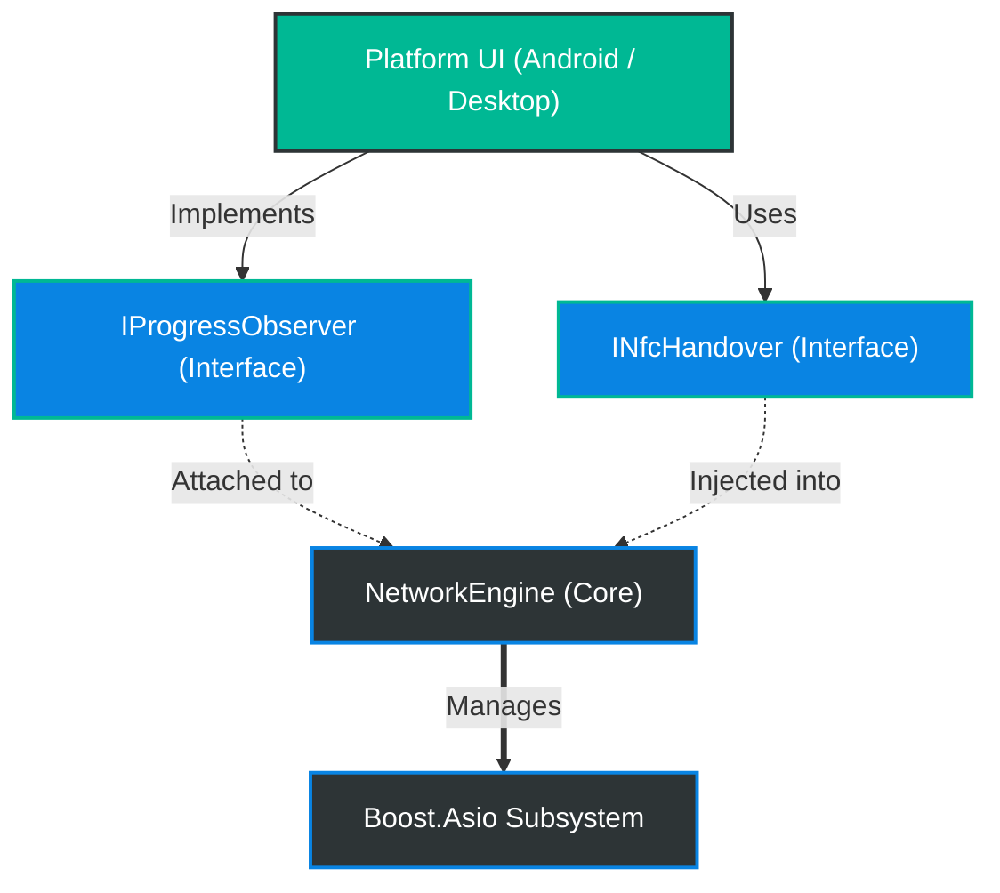

<div align="center">
  

  <br />
  
  <a href="https://github.com/nilay007hckkr/Anyshare">
    
  </a>

  <br />
  
  
  
  

</div>

<br />

<table align="center" width="100%">
  <tr>
    <td align="center" width="50%">
      <h3>Network Engine</h3>
      <p>Utilizes asynchronous TCP sockets via Boost.Asio for non-blocking, lightning-fast 64KB chunk streaming.</p>
    </td>
    <td align="center" width="50%">
      <h3>Polymorphic Handover</h3>
      <p>Injectable strategy pattern allows seamless connection discovery via NFC, QR Codes, or Bluetooth.</p>
    </td>
  </tr>
  <tr>
    <td align="center" width="50%">
      <h3>UI Agnostic</h3>
      <p>Observer pattern exposes real-time progress updates without locking into any specific graphical framework.</p>
    </td>
    <td align="center" width="50%">
      <h3>Cross Platform</h3>
      <p>Strict C++17 compliance guarantees flawless compilation on Android JNI, Linux, and Windows Desktop.</p>
    </td>
  </tr>
</table>

<br />
<div align="center"></div>
<br />

## Core Architecture

The system is built on a highly modular architecture. The core `NetworkEngine` manages all asynchronous data streams while delegating discovery and progress reporting to injected interfaces.



<br />
<div align="center"></div>
<br />

## Dynamic Transfer Workflow

The following sequence details the lifecycle of a file transfer session, from the initial hardware-level handshake to the completion of the binary stream.

```mermaid
sequenceDiagram
    participant UI as User Interface
    participant Handover as NFC / Handover Layer
    participant Engine as NetworkEngine
    participant Remote as Remote Client

    UI->>Handover: Initiate Discovery
    Handover->>Remote: Out-of-band Handshake
    Remote-->>Handover: ConnectionInfo (IP, Port, Size)
    Handover-->>UI: Handover Complete
    
    rect rgb(45, 52, 54)
    Note over UI,Engine: Transfer Initialization
    UI->>Engine: startTransfer(HandoverStrategy)
    end
    
    rect rgb(9, 132, 227)
    Note over Engine,Remote: Asynchronous Streaming Phase
    Engine->>Remote: TCP async_connect()
    loop For each 64KB chunk
        Engine->>Remote: async_write(buffer)
        Engine->>UI: onProgress(percent)
    end
    Engine->>Remote: Graceful Socket Shutdown
    end
    
    Engine->>UI: onProgress(100)
```



<br />
<div align="center"></div>
<br />

## Build and Setup Instructions

### Prerequisites
- **CMake** (version 3.10 or higher)
- **C++17 Compiler** (GCC, Clang, or MSVC)
- **Boost Libraries** (version 1.74 or higher, specifically `Boost::system`)
- **Threads** (Standard threading library)

### Compilation

The project uses CMake to build a static library (`anyshare_engine`) which can be linked into your respective frontend or desktop application.

1. **Clone the repository:**
   ```bash
   git clone https://github.com/nilay007hckkr/Anyshare.git
   cd Anyshare
   ```

2. **Configure the project:**
   ```bash
   mkdir build
   cd build
   cmake ..
   ```

3. **Build the engine:**
   ```bash
   cmake --build .
   ```

### Application Integration

To use the AnyShare engine in your own application, add the following to your target's `CMakeLists.txt`:

```cmake
add_subdirectory(path/to/Anyshare)
target_link_libraries(your_target PRIVATE anyshare_engine)
```

<br />
<div align="center">
  
</div>

<div align="center">
  <h2>Project Contributors</h2>
  <table align="center" width="80%">
    <tr>
      <td align="center" width="33%">
        <strong>Nilay Joshi</strong><br />
        <i>Core Network & Systems Engineer</i>
      </td>
      <td align="center" width="33%">
        <strong>Mayank Joshi</strong><br />
        <i>Desktop NFC & Hardware Specialist</i>
      </td>
      <td align="center" width="33%">
        <strong>Mohd Almas khan</strong><br />
        <i>Android Mobile & JNI Engineer</i>
      </td>
    </tr>
  </table>
</div>
