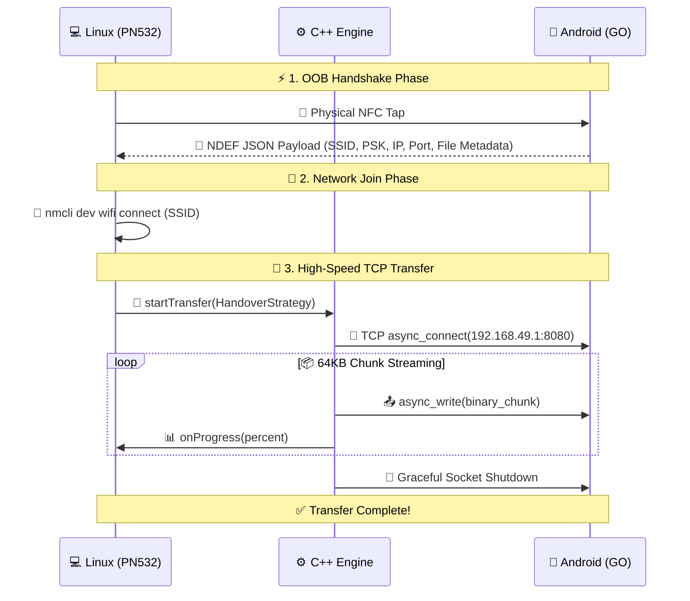

<div align="center">
  

  <br />
  
  <a href="https://github.com/nilay007hckkr/Anyshare">
    
  </a>

  <br />
  
  
  
  
  
  

</div>

<br />

## 📖 1. Project Overview

This project implements a high-performance, cross-platform, out-of-band (OOB) local file transfer system between Linux and Android devices. Designed as a **true off-grid alternative to AirDrop**, it utilizes **Near Field Communication (NFC)** for seamless, zero-configuration device discovery and **Wi-Fi Direct (Ad-Hoc P2P)** for high-speed data transfer.

By leveraging a custom C++17 socket engine, the core file transfer logic is completely decoupled from the hardware and operating system constraints, ensuring high performance, zero memory bloat, and maximum code reusability across platforms.

<br />
<div align="center"></div>
<br />

## 🏗️ 2. System Architecture & Topology

The project utilizes a **True Wi-Fi Direct (P2P)** topology for maximum throughput:

* 📱 **Group Owner (Router):** The Android device acts as the Wi-Fi Direct Group Owner (GO), generating a temporary, hidden Wi-Fi network and assigning itself the static IP `192.168.49.1`.
* 💻 **Client:** The Linux machine acts as the client, receiving the network credentials via NFC and connecting to the hotspot using OS-level network managers.
* ⚙️ **Core Engine:** A shared C++ engine manages asynchronous TCP streams to transfer files over the established local network.

### 📐 2.1 Design Patterns (GoF)
* 🧩 **Strategy Pattern (`INfcHandover`):** Abstracts the network credential exchange mechanism. Allows the core engine to function identically regardless of whether the handover occurs via a physical PN532 module on Linux or native Android APIs.
* 🔌 **Adapter Pattern:** Encapsulates low-level C libraries (`libnfc`) into modern C++ smart pointers to prevent memory leaks and provide an object-oriented interface.
* 📡 **Observer Pattern (`IProgressObserver`):** Decouples the background network threading from the UI, allowing asynchronous progress updates (0-100%) without blocking the data stream.

<br />
<div align="center"></div>
<br />

## 🔄 Dynamic Transfer Workflow (Under the Hood)

Here is a deep dive into the actual file transfer animation and what happens under the hood during a session:



### 📄 Data Payload Specification (NDEF)
The NFC tap transmits a standard JSON payload formatted as an NDEF MIME-type (TNF 2) record to facilitate the zero-config connection:

```json
{
  "ssid": "DIRECT-xy-AndroidHost",
  "psk": "GeneratedPassword123",
  "ip": "192.168.49.1",
  "port": 8080,
  "filename": "heavy_presentation.mp4",
  "filesize": 2147483648
}
```

<br />
<div align="center"></div>
<br />

## 🛠️ 3. Technical Specifications & Requirements

### System Requirements
* 🐧 **Linux Environment:** Debian/Ubuntu-based distribution.
* 🤖 **Android Environment:** Physical Android device (Emulators do not support Wi-Fi Direct or NFC). Android 8.0 (API 26) or higher.
* 🔌 **Hardware:** PN532 NFC/RFID module connected via USB/UART (set to HSU mode via DIP switches).

### Software Dependencies
| Category | Technology |
| :--- | :--- |
| **Standard** | C++17 |
| **Build System** | CMake 3.10+ |
| **Networking** | `Boost.Asio` |
| **Hardware Drivers** | `libnfc` |
| **OS Network Manager** | `nmcli` (NetworkManager) |
| **Mobile** | Android NDK, Java/Kotlin |


### 🚀 Compilation & Integration

The project uses CMake to build a static library (`anyshare_engine`).

1. **Clone & Configure:**
   ```bash
   git clone https://github.com/nilay007hckkr/Anyshare.git
   cd Anyshare && mkdir build && cd build
   cmake ..
   ```

2. **Build the engine:**
   ```bash
   cmake --build .
   ```

3. **Integrate into your CMake project:**
   ```cmake
   add_subdirectory(path/to/Anyshare)
   target_link_libraries(your_target PRIVATE anyshare_engine)
   ```

<br />
<div align="center">
  
</div>

<div align="center">
  <h2>👥 Project Contributors</h2>
  <table align="center" width="80%">
    <tr>
      <td align="center" width="33%">
        <strong>Nilay Joshi</strong><br />
        <i>Core Network & Systems Engineer</i>
      </td>
      <td align="center" width="33%">
        <strong>Mayank Joshi</strong><br />
        <i>Desktop NFC & Hardware Specialist</i>
      </td>
      <td align="center" width="33%">
        <strong>Mohd Almas khan</strong><br />
        <i>Android Mobile & JNI Engineer</i>
      </td>
    </tr>
  </table>
</div>
