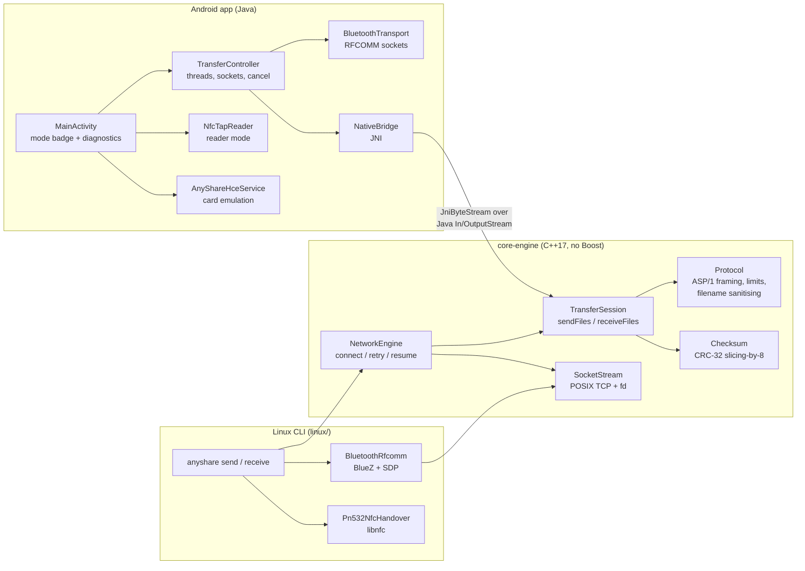
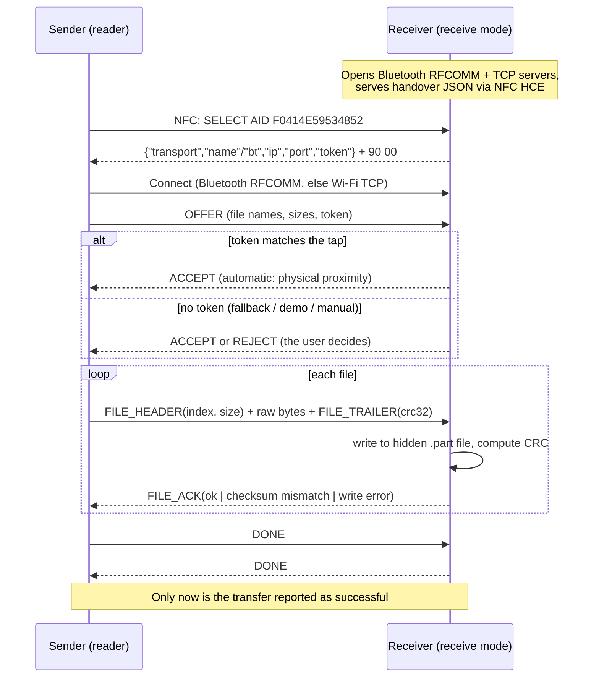

<div align="center">
  

  <br />

  <a href="https://github.com/nilay007hckkr/Anyshare">
    
  </a>

  <br />

  
  
  
  
  
  

</div>

<br />

## 1. Project Overview

AnyShare is an offline, proximity-initiated file sharing system for **Android ↔ Android, Android ↔ Linux, Linux ↔ Android and Linux ↔ Linux**. It is inspired by tap-to-share: the user picks files, brings two devices together, and the files arrive on the other device.

NFC is **not** used to carry the files (it is far too slow). Each step has its own component:

| Step | What happens | Implemented with |
| :--- | :--- | :--- |
| **Handover** | The sender learns *where* the receiver is, plus a one-time token | NFC tap (Android HCE ↔ reader mode, or a PN532 reader on Linux), a simulated tap (demo), or a manually chosen paired device / IP address |
| **Transport** | A byte stream between the two devices | Bluetooth Classic RFCOMM (Android and Linux), or TCP over Wi-Fi/LAN (also works inside a Wi-Fi Direct group) |
| **Transfer** | Files, framing, integrity checks and safe saving | One portable C++17 core (**ASP/1** protocol), used by the Linux CLI directly and by Android through JNI |

The receiver checks every file's CRC-32 and acknowledges it. **A transfer is reported as successful only after the receiver has confirmed every file.** No step is ever simulated silently. Demo mode simulates *only the tap gesture*, labels it as simulated, and still performs a real Bluetooth transfer.

<br />
<div align="center"></div>
<br />

## 2. Architecture



* **`core-engine/`** contains the shared transfer engine. `anyshare_protocol` (the protocol, sender/receiver, CRC and path safety) has no OS dependencies and is the only part compiled into Android. `core_engine` adds POSIX sockets and `NetworkEngine` for Linux.
* **`android/`** is the Java app. Java owns the Bluetooth/TCP sockets and passes their streams to C++ through JNI, so Android and Linux run *the same protocol code*.
* **`linux/`** is the `anyshare` command-line tool. Bluetooth (BlueZ) and NFC (libnfc/PN532) are optional, auto-detected build features.

### 2.1 Design patterns

* **Strategy (`INfcHandover`)**: `Pn532NfcHandover` (physical NFC), `JsonHandover` (payload from a tap/file), `ManualHandover` (typed address or paired device). Every strategy's `describe()` reports truthfully how the handover happened.
* **Fallback decorator (`FallbackHandover`)**: tries NFC, and *only if the hardware is unavailable* uses the Bluetooth/TCP fallback, logging why.
* **Adapter**:
  * `IByteStream` gives one interface over POSIX sockets, BlueZ RFCOMM sockets and Java streams (`JniByteStream`).
  * libnfc's C handles are owned by `std::unique_ptr` with custom deleters.
* **Observer (`IProgressObserver`)**: progress, per-file completion and errors reach the console UI or the Android UI (through JNI) without blocking the transfer.

### 2.2 Repository layout

```
core-engine/            shared C++17 engine (CMake)
  include/ src/         Protocol, TransferSession, Checksum, NetworkEngine, SocketStream, handovers
  test/                 core_tests (unit + loopback integration), demo, stress_test, receiver
  third_party/nlohmann/ vendored json.hpp 3.11.3 (from the Android branch; used when no system package)
linux/                  `anyshare` CLI, `anyshare-gui` Qt desktop app (gui/), BlueZ RFCOMM + libnfc PN532 backends,
                        esp32-nfc-bridge/ (ESP32 firmware for the HW-147C Si512 reader)
android/                Android Studio project (Java); JNI bridge in app/src/main/cpp/
tests/                  run_linux_tests.sh (CLI end-to-end), jni/ (desktop JNI bridge test)
assets/                 README animations
```

<br />
<div align="center"></div>
<br />

## 3. Transfer Workflow

The animations below are illustrative overviews of each direction. The sequence diagram shows the exact message flow implemented in the code.

<details>
  <summary><b>▶ Android to Linux</b></summary>
  <div align="center">
    <br/>
    
  </div>
</details>

<details>
  <summary><b>▶ Linux to Android</b></summary>
  <div align="center">
    <br/>
    
  </div>
</details>

<details>
  <summary><b>▶ Android to Android</b></summary>
  <div align="center">
    <br/>
    
  </div>
</details>

<details>
  <summary><b>▶ Linux to Linux</b></summary>
  <div align="center">
    <br/>
    
  </div>
</details>



### 3.1 ASP/1 wire format (`core-engine/include/Protocol.hpp`)

All integers are big-endian.

| Message | Direction | Layout |
| :--- | :--- | :--- |
| OFFER | S→R | `"ASP1"` · `u8 version=1` · `u8 type=1` · `u32 len` · JSON `{"protocol":1,"sender","token","files":[{"name","size","mime"}]}` |
| RESPONSE | R→S | `u8 type=2` · `u8 status` (accepted/rejected/too large/no space/bad request/busy/version) · `u16 len` · reason |
| FILE_HEADER | S→R | `u8 type=3` · `u32 index` · `u64 size`, then exactly `size` raw bytes |
| FILE_TRAILER | S→R | `u8 type=4` · `u32 crc32` |
| FILE_ACK | R→S | `u8 type=5` · `u32 index` · `u8 status` · `u32 crc32 as received` |
| DONE / CANCEL | both / S→R | `u8 type=6` / `u8 type=7` |

* The connection is one stream, and each file is acknowledged once, so throughput is limited by the link, not by per-chunk round trips.
* If the link drops, `NetworkEngine` reconnects (every 2 s, for up to 60 s) and re-offers **only the files not yet acknowledged**, up to 3 times. The receiver deletes the partial file, so nothing is ever duplicated or corrupted.

### 3.2 Finding receivers by name (UDP discovery)

No IP typing: a sender broadcasts `ANYSHARE?1` to UDP **48080**; every receiver in receive mode answers `ANYSHARE!1|<tcp port>|tcp|<os>|<name>` and its IP is the reply's source address. Implemented in C++ (`linux/src/LanDiscovery.cpp`: `anyshare discover`, `send --to NAME`, the desktop app's *Send to* list, receivers answer automatically) and Java (`android/.../transfer/LanDiscovery.java`: the phone's *Send to* list, phones in receive mode answer with their device name). A found receiver has no session token, so it still asks the user to accept. A Java client found the C++ receiver in a cross-language test.

### 3.3 Handover payload (NFC HCE response / `--handover-file`)

```json
{"v":1,"transport":"rfcomm","name":"Pixel 7","ip":"192.168.1.9","port":8080,"token":"9f2c4e1a7b3d5e60"}
```

* An **Android receiver** advertises its Bluetooth *name*, because Android hides the device's own MAC address from apps. The sender tries paired devices with that name first, then its other paired devices. Only the device actually running AnyShare accepts the connection. The Wi-Fi `ip`/`port` is advertised as an alternative.
* A **Linux receiver** advertises `bt` (MAC) and `ch` (RFCOMM channel), or `ip`/`port`.
* The parser still accepts the earlier schemas from both branches: `main`'s `{"ssid","psk","ip","port","files":[…]}` and the Android branch's `{"filename","filesize",…}`.
* **`"role":"send"`** (optional; default `"receive"`): the device that published the payload has the files and waits. The reader connects to it, sends a `PULL` request carrying the token, and then receives as usual. This is how a phone sends to a laptop whose NFC module (ESP32 + Si512) can read phones but cannot act as an NFC card itself. A connection without the right token gets nothing.

<br />
<div align="center"></div>
<br />

## 4. Transfer Modes, Fallback and Demo Mode (Android sender)

| Mode | How the sender finds the receiver | Transport | Receiver authorisation |
| :--- | :--- | :--- | :--- |
| **Hardware NFC** (default) | Physical tap: reader mode reads the receiver's HCE payload | Bluetooth RFCOMM, else Wi-Fi TCP | automatic (tap token) |
| **Bluetooth fallback** | Pick a paired device, or enter an IP address | Bluetooth RFCOMM / TCP | receiver taps **Accept** |
| **NFC-style demo** | Tap the animation card: the tap is **simulated**, and the target is a remembered demo partner (paired device or Wi-Fi `host:port`) | **Real** Bluetooth RFCOMM or Wi-Fi TCP | receiver taps **Accept** |

**Activate a mode:** long-press the empty, transparent area at the **top-right of the header**, next to the "AnyShare" title. This opens a *Transfer mode* dialog. Tapping the **Mode badge** under the title opens the same dialog. The area has an accessibility label ("Transfer mode settings"), so TalkBack users can reach it too.

**Return to normal:** open the same dialog and choose **Hardware NFC**. The choice is saved (SharedPreferences) and survives restarts.

**Demo mode in practice:**
1. Pair the two phones once in system Bluetooth settings.
2. On the receiver, tap **Receive**.
3. On the sender, choose files and tap **Send**. Pick the *demo partner*: a paired phone, or **Wi-Fi: enter IP address** (e.g. a laptop running `anyshare receive`). It is remembered. Long-press the animation card later to change it.
4. Tap the animation card. The devices "touch" in the animation, then a real Bluetooth RFCOMM or Wi-Fi TCP connection is made. The receiver shows an Accept dialog (no NFC token was exchanged).

A laptop running the receiver inside WSL has no Bluetooth, so use the Wi-Fi partner option for phone -> laptop demos.

What the screen shows is always accurate:
* The mode badge reads `SIMULATED tap · real Bluetooth / Wi-Fi transfer`.
* The NFC line reads `NFC: not used (simulated tap — demo mode)`.
* The transport line shows the real link, e.g. `Transport: Bluetooth RFCOMM Pixel 7 · Handover: SIMULATED tap (demo mode, no NFC)` or `Transport: Wi-Fi TCP 10.119.2.168:8080 · Handover: SIMULATED tap (demo mode, no NFC)`.
* The same strings are written to `adb logcat -s AnyShare AnyShare.Transfer`.
* The packet animation and the progress bar start only after the receiver has accepted, and progress comes from real byte counts.

If **Hardware NFC** is selected but the phone has no NFC, or NFC is off, pressing Send says so and offers *Use Bluetooth fallback* or *NFC settings*. It never pretends a tap happened.

**Linux sender equivalents:**
* `--nfc` = physical tap via PN532.
* `--handover-file` = simulated tap (`describe()` says so).
* `--bt` / `--tcp` = manual fallback.
* `--nfc --fallback-bt ADDR` uses Bluetooth *only* if the NFC hardware cannot be opened, and prints why.

<br />
<div align="center"></div>
<br />

## 5. Build & Run

### 5.1 Core engine (Linux; this is what CI builds)

```bash
sudo apt install build-essential cmake nlohmann-json3-dev   # json is optional: vendored copy used otherwise
cd core-engine && cmake -S . -B build -DCMAKE_BUILD_TYPE=Release && cmake --build build -j
./build/core_tests                       # unit + loopback integration tests
```

Boost is **no longer required**. Including the engine from another CMake project:

```cmake
add_subdirectory(path/to/Anyshare/core-engine)
target_link_libraries(your_target PRIVATE core_engine)        # Linux: sockets + NetworkEngine
# or anyshare_protocol for the OS-independent protocol only
```

### 5.2 Linux CLI (`linux/`)

```bash
sudo apt install build-essential cmake libbluetooth-dev libnfc-dev   # BT / NFC parts optional
cmake -S linux -B build-linux -DCMAKE_BUILD_TYPE=Release && cmake --build build-linux -j
# The configure output shows "AnyShare: Bluetooth RFCOMM enabled" / "NFC enabled".
```

```bash
# Receive (prints the handover payload; offers carrying its token are auto-accepted)
./build-linux/anyshare receive --dir ~/Downloads/AnyShare                  # TCP :8080
./build-linux/anyshare receive --transport rfcomm                          # Bluetooth
./build-linux/anyshare receive --handover-out /tmp/tap.json                # for a simulated tap

# Send
./build-linux/anyshare send --tcp 192.168.1.9:8080 photo.jpg notes.pdf     # manual, no NFC
./build-linux/anyshare send --bt AA:BB:CC:DD:EE:FF report.pdf              # Bluetooth, SDP lookup
./build-linux/anyshare send --handover-file /tmp/tap.json a.bin            # simulated tap
./build-linux/anyshare send --nfc --nfc-device pn532_uart:/dev/ttyUSB0 \
                            --fallback-bt AA:BB:CC:DD:EE:FF a.bin          # PN532 tap, BT if NFC hw missing

./build-linux/anyshare nfc-probe [pn532_uart:/dev/ttyUSB0]                 # is the PN532 reachable?
./build-linux/anyshare bt-info                                             # local adapter + service UUID
```

**Linux hardware notes:**
* **PN532** connects over USB-UART (set the DIP switches to HSU), I²C (`pn532_i2c:/dev/i2c-1`) or SPI (`pn532_spi:/dev/spidev0.0`).
  * Give your user access to the serial device: `sudo usermod -aG dialout $USER`.
  * Configure `/etc/nfc/libnfc.conf` or pass `--nfc-device`.
  * The PN532 acts as a **reader**, so Linux can *send* after tapping a phone that is in receive mode. Linux as an NFC *card* (a phone taps a Linux receiver) is **not implemented**; use `--handover-out`, a QR code, or the phone's IP-address dialog instead.
* **Bluetooth receive** registers an SDP record so Android can find the service by UUID. On BlueZ 5 this needs bluetoothd's legacy SDP socket: add `--compat` to the `ExecStart` line of `bluetooth.service`. Without it, the CLI warns, and Linux senders can still use `--bt ADDR@CHANNEL`.
* **Android receivers** cannot publish their MAC address. For Linux → Android over Bluetooth, pair the phone, then send with `--bt <phone MAC>` (shown in `bluetoothctl devices Paired`). Alternatively, use the phone's Wi-Fi address with `--tcp` or `--prefer-tcp`.

**Desktop app (Qt):** `bash linux/run_gui.sh` builds and opens `anyshare-gui` (Qt 6, or Qt 5.12+). It uses the same engine as the CLI on worker threads, and the terminal keeps the engine log.
* Send (Linux can send to phones and PCs), receive with an Accept / Decline dialog, progress, the transport actually used.
* The hidden mode menu opens with **three quick right-clicks in the top-right corner** (the desktop twin of the Android long-press): Hardware NFC (only offered when a reader is found), Bluetooth fallback / Manual address, NFC-style demo (SIMULATED tap, real transfer).
* Without an NFC reader the window never mentions NFC.

**HW-147C (Si512) reader + ESP32 OLED:** the Si512 reports version `0x82` like NXP's PN512, so libnfc (PN532) cannot use it. `linux/esp32-nfc-bridge/` is ESP32 firmware that drives it over SPI (it must set the PN512 *Initiator* bit, or no card is ever found). It reads cards (ID + type on the OLED) and is written to read an AnyShare phone's handover (`PAYLOAD {json}`). The CLI (`--esp32 auto`) and the desktop app send transfer progress to its OLED (percent, file name, file type, result, then back to the idle screen) and to an RGB status LED: green idle, blinking red receiving, blinking purple sending, amber error. The desktop app also reads the reader: card taps show their ID and type, and a phone tap (`PAYLOAD`) starts the transfer to that phone. While the laptop receives, the module also acts as an NFC card with the laptop's handover so phones can tap it to send (experimental, not yet verified with a phone). Without an NFC phone, a MIFARE Classic 1K card can carry a small file (about 700 bytes) from the laptop and back; verified on hardware. See HOW_TO_RUN.md §7b.

### 5.3 Android app (`android/`)

Requirements: Android Studio with SDK platform 37, the NDK, and CMake 3.22.1. AGP 9.3.1 and Gradle 9.5.0 come from the wrapper. `minSdk` is 26.

```bash
cd android
./gradlew assembleDebug        # builds Java + libanyshare_jni.so (arm64-v8a, armeabi-v7a, x86_64)
./gradlew test                 # JVM unit tests (APDU format)
adb install -r app/build/outputs/apk/debug/app-debug.apk
adb logcat -s AnyShare AnyShare.Transfer AnyShare.NFC AnyShare.HCE AnyShare.BT
```

* The native build compiles `core-engine/` sources directly; see `android/app/src/main/cpp/CMakeLists.txt`.
* `local.properties` (your SDK path) is created by Android Studio and is git-ignored.
* Physical phones are needed for NFC and Bluetooth. An emulator can exercise only the TCP path and the UI.

### 5.4 JNI bridge on a desktop JVM

`tests/jni/run_jni_desktop_test.sh` compiles the **unmodified** `anyshare_jni.cpp` + `NativeBridge.java` + `ApduProtocol.java` for the host. It then runs real sender/receiver sessions through JNI with `-Xcheck:jni`. It works on Linux and on Windows (Git Bash with MSYS2 g++):

```bash
JAVA_HOME=/path/to/jdk tests/jni/run_jni_desktop_test.sh
```

<br />
<div align="center"></div>
<br />

## 6. Test Results (2026-10-13)

Environment: WSL2 Ubuntu 22.04 (GCC 11.4, CMake 3.22) and Windows 11 (MSYS2 GCC 16.1, JDK 26). **No Android SDK, phone, Bluetooth adapter or NFC reader was available.**

| Suite | Command | Result |
| :--- | :--- | :--- |
| Core unit + integration | `core-engine/build/core_tests` | **112/112 checks pass.** Covers CRC vectors, filename sanitising (traversal, control chars, reserved names, UTF-8 truncation), all handover schemas, offer limits, no-overwrite commit, empty / multi / 256 MiB files, path traversal, reject / token / size limit, connection refused + connect timeout, interrupted transfer, injected corruption, engine resume after a dropped link, cancellation, non-ASP/1 peer |
| Linux CLI end-to-end (Linux ↔ Linux, loopback TCP) | `tests/run_linux_tests.sh` | **24/24 pass**, built both without and with BlueZ + libnfc. Covers simulated tap, duplicate names kept, untokened offer declined, NFC-hardware-missing fallback, Android-format payload, missing file, refused connection, malformed handover, original `demo` executable |
| JNI bridge (desktop JVM, `-Xcheck:jni`) | `tests/jni/run_jni_desktop_test.sh` | **33/33 checks pass.** Covers emoji filenames across UTF-16↔UTF-8, token transfer, prompt/reject, sender cancel, receiver cancel, Java exception propagation, 600-file session (no local-ref leak) |
| Android JVM unit tests | `ApduProtocolTest` (run with JUnit 4.13.2 directly) | **4/4 pass** |
| Linux desktop app (Qt 5.15 and Qt 6.2, headless) | `anyshare-gui-tests` + `tests/run_linux_tests.sh` | **18/18 GUI tests** on both Qt versions; with Qt installed the end-to-end script reports **33/33** (incl. 54 ESP32-bridge and 22 discovery checks). Covers the triple right-click menu, no NFC text without a reader, real send, demo-tap send, accept / decline, CLI → GUI transfer, clean Ctrl-C exit |
| Hardware-missing behaviour (real BlueZ 5.64 + libnfc 1.8.0 libraries, no devices) | `anyshare bt-info / nfc-probe / send --nfc / send --bt` | Clear "NOT available" errors; no false success |

**Not executed (needs hardware or the SDK):**
* `./gradlew assembleDebug` and the Android UI.
* Any real NFC tap (HCE ↔ reader mode, PN532 ↔ phone).
* Any real Bluetooth RFCOMM transfer.
* Android ↔ Android, Android ↔ Linux and Linux ↔ Android on devices.

The Android Java sources were only checked with `javac` without `android.jar`: references between the project's own classes resolve, but Android API usage is unverified until a Gradle build.

**Manual hardware test plan:**
1. `./gradlew assembleDebug`, then install on two NFC phones and pair them.
2. **A→A NFC:** phone B taps **Receive**; phone A picks files, taps **Send**, and holds the phones back-to-back. Expect `Handover: physical NFC tap`, no Accept prompt on B, and `checksums verified`.
3. **A→A Bluetooth fallback / demo:** switch the mode via the header long-press, then repeat. Expect an Accept prompt on B and the mode badge to say what was used.
4. **A→Linux:**
   * Run `anyshare receive` on the laptop, then on the phone use *Send → Wi-Fi: enter IP address* with the printed `ip:port`.
   * With BlueZ and SDP set up, `anyshare receive --transport rfcomm` and the paired-device picker.
5. **Linux→A:** the phone taps **Receive**, then run `anyshare send --tcp <phone ip>:8080 file`, or `--bt <phone MAC> file`, or tap the phone on the PN532 with `--nfc`.
6. **Failure cases:** deny the Bluetooth permission; turn Bluetooth off; walk out of range mid-transfer; tap Cancel on either side. In every case expect an error or "Cancelled", no file saved, and no success message.

<br />
<div align="center"></div>
<br />

## 7. Performance (measured, loopback)

| Metric | Result |
| :--- | :--- |
| 2 GiB file, CLI sender → CLI receiver (WSL2, TCP loopback) | 2.3 s, byte-identical (`cmp`), CRC verified by the receiver |
| Peak RSS for the 2 GiB transfer (`/usr/bin/time -v`) | sender **4.9 MB**, receiver **4.9 MB** |
| 256 MiB in-process (`core_tests`) | ≈1.2–1.7 GiB/s including CRC on both ends |

Real links will be much slower than loopback. Classic Bluetooth RFCOMM typically carries well under 1 MB/s, and Wi-Fi depends on the network. The engine is not the bottleneck. **Measured over the air (2026-10-14):** Bluetooth RFCOMM between a Samsung Galaxy M34 and a laptop (Realtek adapter, Linux in WSL) ran at about 200 KiB/s in both directions. Wi-Fi throughput has not been measured yet.

## 8. Security & Reliability

* **Receiver-side safety:**
  * Peer filenames are reduced to a single sanitised component: no `/`, `\`, `..`, control or reserved characters, hidden-file prefixes or invalid UTF-8.
  * Files are written to a hidden `.part` file and committed only after the CRC matches.
  * Commits use `link()`/`MoveFileEx` semantics, so **existing files are never overwritten** (`name (1).ext`). On Android, files go to `Downloads/AnyShare` through MediaStore, which also never overwrites.
* **Limits:** at most 4096 files, 1 MiB of offer metadata, 255-byte names and 256 GiB per session (Android uses the same defaults). A free-space check runs before accepting.
* **Authorisation:** an offer is auto-accepted only if it carries the one-time token from the receiver's tap payload (compared in constant time). Every other offer needs explicit user approval. A Linux receiver with no terminal declines automatically.
* **Transport security:**
  * Bluetooth uses secure RFCOMM (authenticated and encrypted after pairing), and the Linux listener requires auth + encryption.
  * **TCP is unencrypted.** Use it only on trusted networks. Adding TLS / Noise with the tap token as a pre-shared key is a recommended next step.
* **Exposure and timeouts:**
  * Listeners exist only while receive mode is active.
  * Every read/write has an idle timeout (30 s; 120 s while waiting for a human to accept), and connects have a deadline.
  * Cancellation unblocks pending I/O on both platforms.
* **CRC-32** detects accidental corruption, not deliberate tampering; that is the job of the transport's encryption.

## 9. Branch Integration Notes

| Source | What was kept / changed |
| :--- | :--- |
| `main` (core engine) | Public API (`NetworkEngine::addObserver / connectToHost / startTransfer`, `INfcHandover`, `IProgressObserver::onProgress/onError`, `Crc32Calculator`, `parseConnectionInfo`), the retry policy (2 s / 60 s / 3 retries) and the `demo` / `stress_test` programs compile unchanged. The raw byte stream (no framing, no receiver, sender-side-only checksum) was replaced by ASP/1 with a real receiver. Boost.Asio was removed so the same code builds for the Android NDK. |
| `Android-Almas` (app) | Moved to `android/`. Kept: UI design, cards, colours, packet animation, metadata resolver, size formatting, window insets, the Wi-Fi Direct group-owner code (now `WifiDirectGroupOwner.java`, not yet wired in), `JsonHandover` + its clear "missing field" errors, and the vendored `nlohmann/json.hpp`. Removed: Android Beam (gone since Android 10; it could never trigger), `simulateTransfer()` (it showed success without sending anything), the never-built `transfer_engine` JNI stub, and NFC as a *required* feature (it blocked installs). Untracked: committed `.gradle/`, `build/`, `.idea/`, `local.properties`. |
| Android branch root engine (`src/`, `include/`) | Superseded by `core-engine/` (it was a single-file subset). Its RAII shutdown, configurable timeout and field validation were carried over. |

## 10. Troubleshooting

| Symptom | Fix |
| :--- | :--- |
| `Native transfer engine failed to load` (Android) | The NDK/CMake build did not produce `libanyshare_jni.so` for your ABI. Check the *Build → Native* output and that the NDK + CMake 3.22.1 are installed. |
| Tap does nothing | Both phones need NFC on. The receiver must be in **Receive**, and the sender must have tapped **Send** in Hardware NFC mode. Some phones need the screen unlocked for HCE. |
| `"Pixel 7" is not a paired device` | Pair the phones once in system Bluetooth settings. Android cannot connect by name to unpaired devices in this app. |
| Linux `AnyShare service not found` / Android can't find a Linux receiver | Run bluetoothd with `--compat` (SDP), or use `--bt ADDR@CHANNEL`. |
| `nfc-probe`: `no NFC reader could be opened` | Check the wiring and DIP switches (HSU), `dialout` group membership, `/etc/nfc/libnfc.conf`, and try `--nfc-device pn532_uart:/dev/ttyUSB0`. Under WSL, USB devices need `usbipd`. |
| `declined: no token and no terminal` | Run `anyshare receive` in a terminal (to answer the prompt), or use `--yes` for unattended tests. |

## 11. Status, Limitations and Next Steps

| Feature | Status |
| :--- | :--- |
| ASP/1 core: framing, receiver, CRC verification, resume, cancellation, limits, safe paths | **Implemented and tested** (automated) |
| Linux CLI over TCP (Linux ↔ Linux) | **Implemented and tested** end-to-end on loopback |
| Linux desktop app (Qt) | **Implemented and tested** headless (Qt 5 + Qt 6); phone ↔ laptop on real devices pending |
| HW-147C (Si512) + ESP32 NFC bridge | **Tested on hardware:** reader found (version 0x82), MIFARE Classic card read (UID 7672F906), OLED progress during a real 300 MiB transfer. Phone read (`PAYLOAD`) **not tested** (no NFC phone yet) |
| JNI bridge (Java ↔ C++) | **Implemented and tested** on a desktop JVM. Not yet run on Android |
| Android app (send/receive UI, permissions, MediaStore, modes, demo) | **Implemented, not compiled** (no SDK here) and not run on a device |
| Android NFC tap (HCE + reader mode) | **Implemented, not verified on hardware** |
| Bluetooth RFCOMM (Android ↔ Android, Android ↔ Linux) | **Implemented, not verified on hardware**. Linux side compiles and links against BlueZ 5.64 |
| PN532 reader on Linux (libnfc) | **Implemented, not verified on hardware**. Compiles against libnfc 1.8.0 and reports a missing device correctly |
| NFC demo mode | **Implemented**: simulated tap (labelled), real Bluetooth or Wi-Fi transfer |
| Linux as NFC card (phone taps Linux receiver) | **Not implemented** |
| Wi-Fi Direct automatic group + join | **Not implemented** (code preserved, not wired). TCP works on an existing P2P group |
| Transport encryption for TCP | **Not implemented** |

Next steps, in order:
1. Run `./gradlew assembleDebug` and fix any SDK compile issues.
2. Execute the manual hardware test plan (§6).
3. Measure real Bluetooth and Wi-Fi throughput.
4. Add an encrypted TCP channel.
5. Add PN532 card emulation (`nfc_target_init`) so phones can tap a Linux receiver.
6. Wire in Wi-Fi Direct for high-speed phone ↔ phone transfers.
7. Rename the Android package from `com.example.myapplication` before any release.

<br />

<div align="center">
  
</div>

<div align="center">
  <h2>Project Contributors</h2>
  <table align="center" width="80%">
    <tr>
      <td align="center" width="33%">
        <strong>Nilay Joshi</strong><br />
        <i>Core Network & Systems Engineer</i>
      </td>
      <td align="center" width="33%">
        <strong>Mayank Joshi</strong><br />
        <i>Desktop NFC & Hardware Specialist</i>
      </td>
      <td align="center" width="33%">
        <strong>Mohd Almas khan</strong><br />
        <i>Android Mobile & JNI Engineer</i>
      </td>
    </tr>
  </table>
</div>
