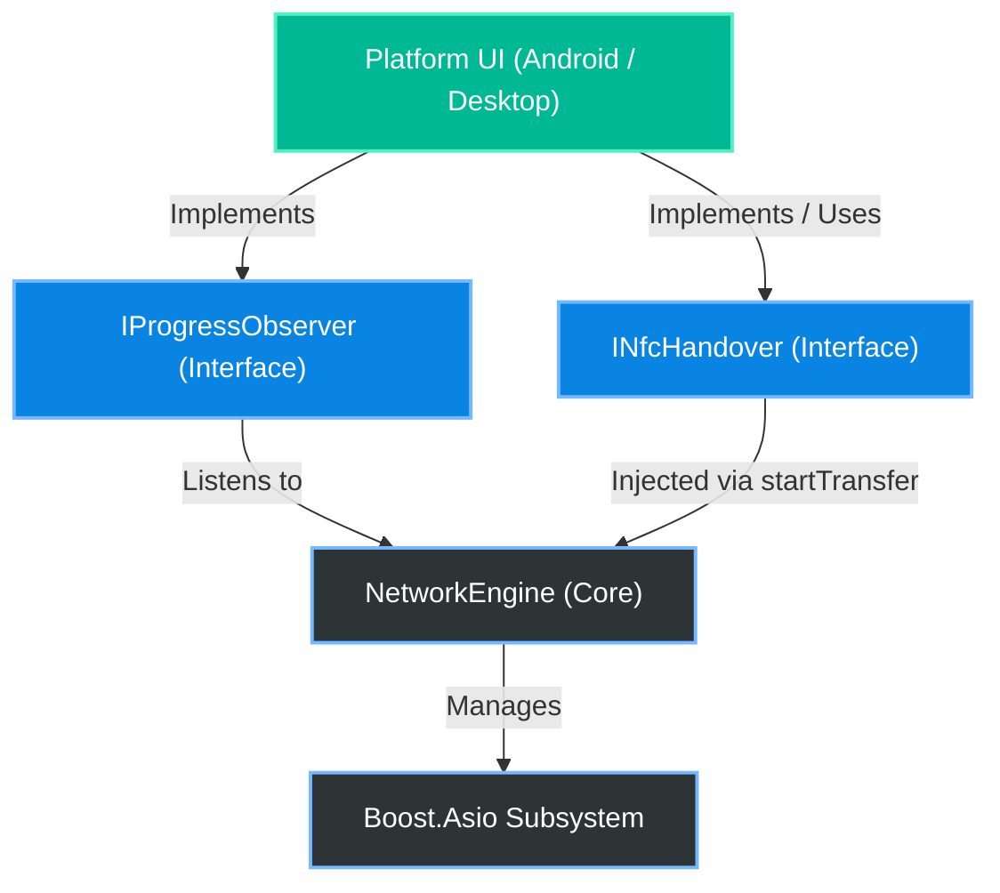

<div align="center">
  <a href="https://github.com/nilay007hckkr/Anyshare">
    
  </a>

  <br />
  
  
  
  

  <p><strong>A robust, modular engine decoupling networking from UI and Handover mechanisms.</strong></p>
</div>

<hr />

## Core Architecture

The system is built on a decoupled architecture using modern C++17 and Boost.Asio. The core `NetworkEngine` manages all asynchronous TCP socket operations, while delegating discovery and progress reporting to injected interfaces.



## Transfer Workflow

The following sequence details the lifecycle of a file transfer session, from the initial hardware-level handshake to the completion of the TCP binary stream.

```mermaid
sequenceDiagram
    participant UI as User Interface
    participant Handover as NFC / Handover Layer
    participant Engine as NetworkEngine
    participant Remote as Remote Client

    UI->>Handover: Initiate Discovery
    Handover->>Remote: Out-of-band Handshake (NFC/QR/BLE)
    Remote-->>Handover: ConnectionInfo (IP, Port, File Metadata)
    Handover-->>UI: Handover Complete
    UI->>Engine: startTransfer(HandoverStrategy)
    
    rect rgb(45, 52, 54)
    Note over Engine,Remote: Asynchronous Transfer Phase
    Engine->>Remote: TCP async_connect()
    loop For each 64KB chunk
        Engine->>Remote: async_write()
        Engine->>UI: onProgress(percent)
    end
    Engine->>Remote: Graceful Socket Shutdown
    end
    
    Engine->>UI: onProgress(100)
```



## Build and Setup Instructions

### Prerequisites
- CMake (version 3.10 or higher)
- C++17 compatible compiler (GCC, Clang, or MSVC)
- Boost Libraries (version 1.74 or higher, specifically `Boost::system`)
- Threads (Standard threading library)

### Compilation

The project uses CMake to build a static library (`anyshare_engine`) which can be linked into your respective frontend or desktop application.

1. Clone the repository and navigate to the root directory:
   ```bash
   git clone https://github.com/nilay007hckkr/Anyshare.git
   cd Anyshare
   ```

2. Create a build directory and configure the project:
   ```bash
   mkdir build
   cd build
   cmake ..
   ```

3. Build the engine:
   ```bash
   cmake --build .
   ```

### Integration into other CMake Projects

To use the AnyShare engine in your own application (such as the desktop GUI or Android JNI wrapper), add the following to your target's `CMakeLists.txt`:

```cmake
add_subdirectory(path/to/Anyshare)
target_link_libraries(your_target PRIVATE anyshare_engine)
```

<hr />

<div align="center">
  <h2>Contributors</h2>
  <table align="center">
    <tr>
      <td align="center"><strong>Nilay Joshi</strong><br />Core Network & Systems Engineer</td>
      <td align="center"><strong>Mayank Joshi</strong><br />Desktop NFC & Hardware Specialist</td>
      <td align="center"><strong>Mohd Almas khan</strong><br />Android Mobile & JNI Engineer</td>
    </tr>
  </table>
</div>
