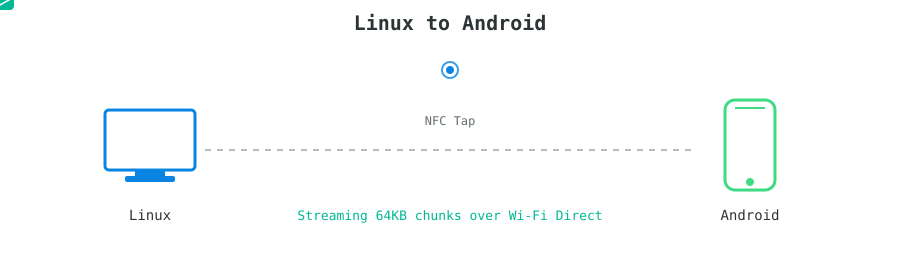
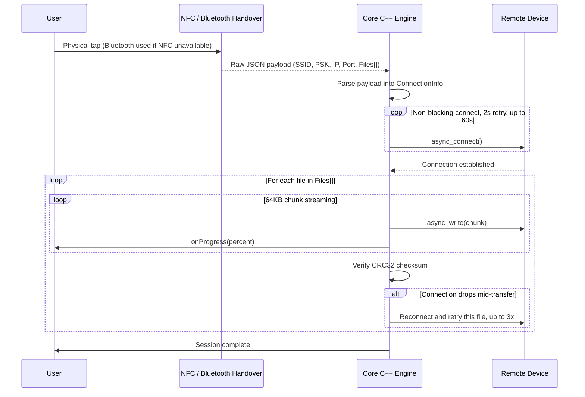

<div align="center">
  

  <br />

  <a href="https://github.com/nilay007hckkr/Anyshare">
    
  </a>

  <br />

  
  
  
  
  
  

</div>

<br />

## 1. Project Overview

This project implements a high-performance, cross-platform, out-of-band (OOB) local file transfer system between Linux and Android devices. It fills a real gap: cloud transfer needs internet, Bluetooth alone is too slow for gigabyte-scale files, and most wireless transfer tools are locked inside a single vendor's ecosystem. AnyShare solves this with **NFC** (or a **Bluetooth fallback** when NFC hardware isn't available) for zero-configuration device discovery, and **Wi-Fi Direct** for the actual high-speed transfer.

By leveraging a custom C++17 socket engine, the core file transfer logic is completely decoupled from the hardware and operating system, ensuring high performance, zero memory bloat, and maximum code reusability across platforms.

<br />
<div align="center"></div>
<br />

## 2. System Architecture & Topology

The project utilizes a True Wi-Fi Direct (P2P) topology for maximum throughput:

* **Group Owner (Router):** The Host device acts as the Wi-Fi Direct Group Owner (GO), generating a temporary, hidden Wi-Fi network and assigning itself the static IP `192.168.49.1`.
* **Client:** The Client machine receives the network credentials via NFC (or Bluetooth) and connects to the hotspot using OS-level network managers.
* **Core Engine:** A shared C++ engine manages asynchronous TCP streams to transfer files over the established local network.

### 2.1 Design Patterns (GoF)
* **Strategy Pattern (`INfcHandover`):** Abstracts the credential-exchange mechanism. The engine works identically whether the handover came from a physical PN532 module on Linux, native Android NFC APIs, or a Bluetooth RFCOMM fallback when NFC hardware isn't detected.
* **Factory Pattern:** Sits between the hardware-compatibility check and the engine — selects which concrete `INfcHandover` strategy to construct (NFC vs. Bluetooth) based on what the device actually has available.
* **Adapter Pattern:** Encapsulates low-level C libraries (`libnfc`) into modern C++ smart pointers to prevent memory leaks and provide an object-oriented interface.
* **Observer Pattern (`IProgressObserver`):** Decouples the background network thread from the UI, allowing asynchronous progress updates (0-100%) and error reporting without blocking the data stream.

<br />
<div align="center"></div>
<br />

## 3. Dynamic Transfer Workflow (Under the Hood)

Here is a deep dive into the actual file transfer flow across all supported platform combinations. Click to expand each transfer scenario:

<details>
  <summary><b>▶ Android to Linux</b></summary>
  <div align="center">
    <br/>
    
  </div>
</details>

<details>
  <summary><b>▶ Linux to Android</b></summary>
  <div align="center">
    <br/>
    
  </div>
</details>

<details>
  <summary><b>▶ Android to Android</b></summary>
  <div align="center">
    <br/>
    
  </div>
</details>

<details>
  <summary><b>▶ Linux to Linux</b></summary>
  <div align="center">
    <br/>
    
  </div>
</details>

<br />



### Data Payload Specification (NDEF / Bluetooth JSON)
The handover layer transmits a JSON payload carrying connection credentials and a list of one or more files to send:

```json
{
  "ssid": "DIRECT-xy-AndroidHost",
  "psk": "GeneratedPassword123",
  "ip": "192.168.49.1",
  "port": 8080,
  "files": [
    {
      "filename": "heavy_presentation.mp4",
      "mimeType": "video/mp4",
      "filesize": 2147483648,
      "checksum": "a1b2c3d4"
    }
  ]
}
```

<br />
<div align="center"></div>
<br />

## 4. Verified Performance

The core engine has been stress-tested against a real 2GB file, with memory measured using `/usr/bin/time -v` rather than estimated:

| Metric | Result |
| :--- | :--- |
| File size streamed | 2,147,483,648 bytes (2.0 GB) |
| Peak RAM used | **~4 MB** |
| Byte-for-byte correctness | Confirmed identical (`diff`) |
| Checksum verification | Passed (CRC32) |
| Mid-transfer disconnect recovery | Confirmed — automatic reconnect and retry, up to 3 attempts per file |

<br />
<div align="center"></div>
<br />

## 5. Technical Specifications & Requirements

### System Requirements
* **Linux Environment:** Debian/Ubuntu-based distribution.
* **Android Environment:** Physical Android device (Emulators do not support Wi-Fi Direct or NFC). Android 8.0 (API 26) or higher.
* **Hardware:** PN532 NFC/RFID module connected via USB/UART (set to HSU mode via DIP switches), or Bluetooth as a fallback.

### Software Dependencies
| Category | Technology |
| :--- | :--- |
| **Standard** | C++17 |
| **Build System** | CMake 3.10+ |
| **Networking** | `Boost.Asio` |
| **JSON Parsing** | `nlohmann/json` |
| **Hardware Drivers** | `libnfc` |
| **OS Network Manager** | `nmcli` (NetworkManager) |
| **Mobile** | Android NDK, Java/Kotlin |

### Compilation & Integration

The engine lives in `core-engine/` and builds as a static library (`core_engine`).

1. **Clone & configure:**
```bash
   git clone https://github.com/nilay007hckkr/Anyshare.git
   cd Anyshare/core-engine
   mkdir build && cd build
   cmake ..
```

2. **Build the engine:**
```bash
   cmake --build .
```

3. **Integrate into your own CMake project:**
```cmake
   add_subdirectory(path/to/Anyshare/core-engine)
   target_link_libraries(your_target PRIVATE core_engine)
```

<br />
<div align="center">
  
</div>

<div align="center">
  <h2>Project Contributors</h2>
  <table align="center" width="80%">
    <tr>
      <td align="center" width="33%">
        <strong>Nilay Joshi</strong><br />
        <i>Core Network & Systems Engineer</i>
      </td>
      <td align="center" width="33%">
        <strong>Mayank Joshi</strong><br />
        <i>Desktop NFC & Hardware Specialist</i>
      </td>
      <td align="center" width="33%">
        <strong>Mohd Almas khan</strong><br />
        <i>Android Mobile & JNI Engineer</i>
      </td>
    </tr>
  </table>
</div>
